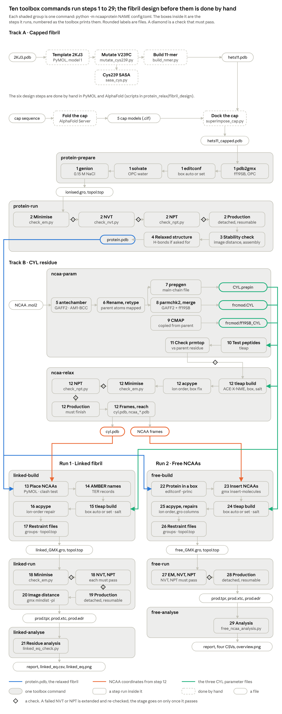

# Walkthrough: HET-s fibril with Cys–maleimide–PEG12–biotin

This walkthrough takes you from three input files to every result in this folder, and to the full trajectories, which
are not stored here. It follows the toolbox's stages in order: what each one does, the settings this system uses,
the files it writes and what you should see in them.

The system is an 11-chain HET-s(218–289) fibril with an engineered "poison" cap docked on one end (chain L), carrying
the non-canonical residue CYL (Cys–maleimide–PEG12–biotin) at Cys239 of chain A and at residue 130 of the cap. Three
simulations are run:

- **the capped fibril on its own** (steps 1–4), relaxed in water before anything is attached;
- **Run 1**: the fibril with CYL attached at the two sites (steps 13–21);
- **Run 2**: the fibril with 40 free capped CYL molecules around it (steps 22–29).

## Before you start

**Software:** GROMACS 2026.3 or newer (`gmx_mpi`), AmberTools, acpype 2026.9.3 or newer, PyMOL, and Python 3.11 or
newer with NumPy, NetworkX, ParmEd, MDAnalysis and matplotlib. A GPU is assumed for the simulations. Install the
toolbox as the [main README](../../README.md#install) describes: its `environment.yml` installs all of these at the
versions the study used. Then work from this folder:

```bash
conda activate ncaaprotein
cd examples/hets_cyl
python -m ncaaprotein -h      # lists the stages
```

If PyMOL is not on your `PATH`, give its full path under `[tools]` in `config.toml` (`pymol = "/path/to/pymol"`).

**Inputs:** three files, all in this folder.

| File | What it is |
|---|---|
| `protein_relax/hets11_capped.pdb` | the capped fibril, protein only, chains A–L; designed by hand (see "Design" below) |
| `ncaa/12EO_linker.mol2` | the CYL molecule drawn capped, ACE–CYL–NME, with hydrogens |
| `config.toml` | every setting of every stage |

**Time and disk.** The simulations dominate. On the GPU the study used, they ran at:

| Run | Length | Speed | Wall time | Trajectory |
|---|---|---|---|---|
| capped fibril | 150 ns | 354 ns/day | about 10 h | 8 GB, whole system |
| CYL in water | 1 ns | 847 ns/day | a few minutes | 0.2 GB |
| Run 1 | 200 ns | 442 ns/day | about 11 h | 13 GB, whole system |
| Run 2 | 200 ns | 169 ns/day | about 28 h | 1.6 GB, fibril and CYL only |

**Where your run goes.** Every stage writes into its own folder under `work/` (set by `workdir` in `config.toml`),
next to this example's folders, so each file you make can be compared with its counterpart here. Never set
`workdir = "."`: the toolbox would then write into this example's folders and over its results.

## The pipeline



Each shaded group in the figure is one command; the boxes inside it are the steps it runs, numbered as the toolbox
prints them. The order:

```bash
# the capped fibril, and the residue: independent of each other, so they can run at the same time
nohup python -m ncaaprotein protein-prepare protein-run config.toml > protein.out 2>&1 &
python -m ncaaprotein ncaa-param ncaa-relax config.toml

# when both have finished: the two runs, also independent of each other
nohup python -m ncaaprotein linked-build linked-run linked-analyse config.toml > run1.out 2>&1 &
nohup python -m ncaaprotein free-build free-run free-analyse config.toml > run2.out 2>&1 &
```

Each `mdrun` is started in its own session, so it carries on if your terminal closes. Run a command again and the
stage resumes after its last finished step; a production that stopped is continued from its checkpoint. Each stage
folder holds `REPORT.md` (every check and its result), `commands.log` (every command run) and `logs/`.

With two GPUs, give Run 1 and Run 2 one each: put `CUDA_VISIBLE_DEVICES=0` and `CUDA_VISIBLE_DEVICES=1` in front of
the two commands.

## Design: the capped fibril (by hand, before step 1)

`protein_relax/hets11_capped.pdb` comes from six steps done by hand in PyMOL and on the AlphaFold Server: the HET-s
template from PDB 2KJ3, the V239C mutation, the solvent accessibility of Cys239, an 11-chain stack, the folded cap,
and the cap docked on the fibril end. The scripts and the instructions are in
[`protein_relax/fibril_design/`](protein_relax/fibril_design/README.md). You only need them to make the structure
yourself; the toolbox starts from the file already here.

Every chain starts at Met217, the methionine of the expression construct in 2KJ3. It is kept in the capped-fibril run
and removed when the linked and free systems are built (`[remove]` in `config.toml`, `when = "builds"`). At 4 fs its
S–CH₃ raises LINCS warnings, so `[tools] mdrun_env = {GMX_MAXCONSTRWARN = "-1"}` stops `gmx mdrun` from giving up
after 1,000 of them.

## Steps 1–4 · `protein-prepare`, `protein-run`: the capped fibril in water

```bash
python -m ncaaprotein protein-prepare protein-run config.toml
```

**Step 1** (`protein-prepare`) builds the system: `pdb2gmx` with ff19SB and OPC water, a box with 1.2 nm of water
around the fibril (`[relax] box_d = 1.2`), water, and 0.15 M NaCl from `gmx genion` (`salt = 0.15`).

**Steps 2–4** (`protein-run`):

- **Step 2** minimises, runs NVT and NPT with every protein heavy atom restrained (2 fs), then 150 ns of production
  at 4 fs with repartitioned hydrogen masses (`production_ns = 150`). Nothing is restrained in production: the
  `restrain` line is left out. Each equilibration must pass its checks before the next run starts; NPT's density
  must fall in `density_range = [1025, 1055]` kg/m³.
- **Step 3** makes the fibril whole in every frame, measures its distance to its own periodic image, and runs two
  stability checks: the toolbox's general one (`assembly_stability.*`) and the one written for this capped rod
  (`[relax.stability]`, `check_capped_stability.py`, which compares the cap junction with the fibril's own).
- **Step 4** counts the hydrogen bonds across the five interfaces under `[relax] hbond` and writes the relaxed fibril.

**Files** (in `work/protein_relax/`; the ones kept in this example are in `protein_relax/`):

| File | What it is |
|---|---|
| `em.png`, `nvt.png`, `npt.png` with `potential.xvg`, `nvt.xvg`, `npt.xvg` and their `.csv` | the equilibration checks |
| `prod.xtc`, `prod.edr`, `prod.log` | the production: trajectory of the whole system every 10 ps, energies, log |
| `nojump_prod.xtc` | the same trajectory with the fibril whole and not jumping across the box |
| `mindist_pi.xvg` | the distance to the periodic image, every 100 ps |
| `assembly_stability.*`, `stability.*`, `check_energy.xvg` | the two stability checks, and the energies they read |
| `hb_AB.xvg` … `hb_KL.xvg` | hydrogen bonds per interface |
| `protein.pdb` | the relaxed fibril at the end of the run |

**What you should see:**

- Minimisation converged; every NVT and NPT line PASS; density about 1043 kg/m³.
- Every interface keeps 75–92% of its contacts. The cap junction (K–L) is about 1.2 Å wider than the fibril's own and
  holds about half the backbone hydrogen bonds of the free end A–B (5.9 against 11.5), below the width at which it
  would count as coming apart.
- Hydrogen bonds over the second half: A–B 21.7, E–F 18.1, F–G 19.6, H–I 22.0, K–L 11.8.
- **Image distance FAIL**: 1.04 nm at 65.9 ns. With 1.2 nm of water the fibril comes within reach of its own image
  for a few nanoseconds (58–66 ns) and stays clear afterwards. Leaving `box_d` out gives the automatic box, which
  avoids this at the cost of a larger system.

## Steps 5–11 · `ncaa-param`: parameters for CYL

```bash
python -m ncaaprotein ncaa-param config.toml
```

From `ncaa/12EO_linker.mol2` the stage derives the residue's parameters: AM1-BCC charges and GAFF2 types with
antechamber (step 5); the backbone, the caps and the atoms CYL shares with cysteine (CB and SG, `parent_atoms`) put
on ff19SB names, types and charges (step 6); the main-chain file and `prepgen` (step 7); missing parameters from
`parmchk2`, merged into one frcmod (step 8); a CMAP term for the new residue (step 9); test peptides built in tleap
(step 10); and a check of their topology against plain cysteine (CYX) (step 11).

**Files** (in `work/ncaa/`; kept here in `ncaa/`): `CYL.prepin`, `frcmod.CYL` and `frcmod.ff19SB_CYL`, the three files
every later build loads; `ncaa_map.json`, which atom became which; `check_prmtop.txt`, the step 11 check.

**What you should see:** `ALL CHECKS PASSED`. `CYL.prepin` and `frcmod.ff19SB_CYL` match the files here byte for byte;
`frcmod.CYL` builds the same topology (it may differ in its title line and in improper lines that repeat GAFF2's
generic term).

## Step 12 · `ncaa-relax`: the residue alone in water

```bash
python -m ncaaprotein ncaa-relax config.toml
```

ACE–CYL–NME is solvated in a 12 Å truncated octahedron of OPC water with 26 Na⁺/Cl⁻ pairs (`[ncaa.relax] box`,
`ion_pairs`), minimised, equilibrated by NPT, and run for 1 ns (`production_ns = 1.0`). The stage then exports the
conformation grafted onto the fibril in Run 1 (`graft_frame_ps = 1000`) and the four scattered in Run 2
(`frames_ps = [250, 500, 750, 1000]`), and measures how far the residue reaches.

**Files** (in `work/ncaa_relax/ace_cyl_nme.amb2gmx/`; kept here in `ncaa_relax/ace_cyl_nme.amb2gmx/`): `cyl.pdb`,
`ncaa_250.pdb` … `ncaa_1000.pdb`, `reach.json`, and the checks and logs of the three runs.

**What you should see:** minimisation "usable" (it stops at machine precision with the largest force below 1000);
NPT every line PASS; a reach from Cα of median 3.38 nm, 95% 4.13 nm, largest 4.38 nm, and 7.07 nm fully stretched.
The reach sizes the automatic box; this example sets its boxes by hand (`box = 12.0`), so 1 ns is enough.

## Steps 13–21 · Run 1: CYL attached

```bash
python -m ncaaprotein linked-build linked-run linked-analyse config.toml
```

**Steps 13–17** (`linked-build`): PyMOL grafts `cyl.pdb` onto Cys239 of chain A and residue 130 of chain L
(`[attach] sites`) and checks that it does not clash with the protein (step 13). Met217 is removed from every chain,
residues get AMBER names (step 14), tleap builds the system with a 12 Å buffer of water and 0.15 M NaCl (step 15),
acpype converts it to GROMACS (step 16), and the restraint files and index groups are written (step 17).

The fibril it starts from is set by `[linked] protein = "linked/hets11_capped_9.5ns.pdb"`: the structure Run 1 of the
study was built from. Leave the line out to start from `protein.pdb` at the end of your own step 4.

tleap takes ion counts rather than a concentration, so the toolbox counts the waters tleap placed and adds
round(0.15 × waters / 55.5) Na⁺/Cl⁻ pairs on top of the ions that neutralise the system.

**Steps 18–20** (`linked-run`): minimisation, NVT and NPT with every solute heavy atom restrained, then 200 ns of
production at 4 fs with every atom of chains F and G held at 200 kJ/mol/nm²
(`restrain = {chains = ["F", "G"], atoms = "all", fc = 200}`), so the rod cannot turn in its box. Step 20 measures the
distance of the fibril and its CYL to their own periodic image.

**Step 21** (`linked-analyse`) follows each CYL from its anchor (SG) to its tip (the biotin sulfur, `tip = "S1"`):
how often it lies on the fibril, how often its biotin touches it, and from when the run has settled.

**Files** (in `work/linked/` and `work/linked/linked.amb2gmx/`; kept here in `linked/`):

| File | What it is |
|---|---|
| `protein_ncaa.pdb`, `protein_ncaa_noh.pdb`, `build_check.pdb` | the fibril with CYL grafted, the same renamed for tleap, and the built solute |
| the equilibration checks, `prod.edr`, `prod.log`, `prod_energy.xvg` | as for the capped fibril |
| `prod.xtc` | production, whole system every 10 ps |
| `solute.gro`, `solute.xtc` | fibril and CYL only, every 10 ps (step 21) |
| `whole_solute.xtc`, `mindist_pi.xvg` | fibril and CYL made whole every 100 ps, and their image distance (step 20) |
| `linked_eq.csv`, `linked_eq.png`, `linked_eq_report.txt` | the analysis of the two CYL |

**What you should see:**

- Every equilibration line PASS.
- **Image distance FAIL**: 0.91 nm at 20.7 ns. The 12 Å buffer is too small for this residue; the automatic box (leave
  `box` out) is sized from its reach.
- Both CYL lie on the fibril about 78% of the time, the biotin tip on it 75% (chain A) and 63% (cap) of the time. The
  report says the run is too short to judge equilibration from the variation it sees.

## Steps 22–29 · Run 2: free CYL

```bash
python -m ncaaprotein free-build free-run free-analyse config.toml
```

**Steps 22–26** (`free-build`): the fibril is put in a box with 1.5 nm around it (`insert_d`), 40 capped CYL
(`n_ncaa = 40`) are inserted around it, 10 from each of the four frames of step 12, and the system is built in tleap
(12 Å buffer, 0.15 M NaCl), converted with acpype and given its restraint file and index groups. It starts from the
study's fibril, `[free] protein = "free/hets11_capped_101.2ns.pdb"`.

**Steps 27–28** (`free-run`): minimisation, NVT, NPT at 4 fs, then 200 ns of production with the backbone of chains F
and G held at 200 kJ/mol/nm². The trajectory holds the fibril and the CYL only.

**Step 29** (`free-analyse`): has the run settled, do the CYL come and go, and which part of the CYL makes the
contacts (its four parts named in `part_names`: cys+caps, spacer, biotin, PEG).

**Files** (in `work/free/` and `work/free/free.amb2gmx/`; kept here in `free/`): `protein_noh.pdb` and `ncaa_noh.pdb`
(the tleap inputs); the equilibration checks; `prod.xtc`, `prod.edr`, `prod.log`, `prod_energy.xvg`; `solute.gro`;
and `free_ncaa_report.txt`, `free_ncaa_overview.png` and four CSV tables.

**What you should see:**

- NPT: every line PASS except the solute temperature, about 3 K above 298 K while the water is at it. This is the
  known effect of a 4 fs step with repartitioned hydrogen masses, and the stage says so. `[free] accept = ["npt"]`
  lets the run go on; without it the stage stops before production and advises running the NPT at 2 fs.
- On average 9 CYL on the fibril; 32 of the 40 visit it, with 84 arrivals and 80 departures over 200 ns; 2 stay on it
  for more than 90% of the run. The settling checks FAIL for this run length: the number on the fibril, their radius
  of gyration and the largest cluster are still drifting at 200 ns.

## Your results against this example

| Stage | Your folder | This example |
|---|---|---|
| steps 1–4 | `work/protein_relax/` | `protein_relax/` |
| steps 5–11 | `work/ncaa/` | `ncaa/` |
| step 12 | `work/ncaa_relax/` | `ncaa_relax/` |
| steps 13–21 | `work/linked/` | `linked/` |
| steps 22–29 | `work/free/` | `free/` |

The example keeps a selection: no trajectories, no run inputs (`.tpr`), checkpoints, index or topology files, which
the stages make again in seconds to minutes. A few files are stored differently:

- `prod.log.gz`: the production logs, gzipped.
- `prod_0-100ns.edr` and `prod_100-200ns.edr` in Run 1 and Run 2: the production energy files, split at 100 ns. Join
  them with `gmx eneconv -f prod_0-100ns.edr prod_100-200ns.edr -o prod.edr` to compare with yours.
- The structures the runs started from have descriptive names: `protein_relax/hets11_capped_0ns.pdb` (and `_20ns`,
  `_60ns`), `linked/hets11_capped_9.5ns.pdb`, `free/hets11_capped_101.2ns.pdb`.

Simulations are not bit-reproducible across machines or GPUs, so frame-by-frame numbers will differ. The checks, the
averages and the image-distance verdicts are what to compare.

## Making the trajectories into movies

The trajectories hold the whole system or jump across the periodic box. To view them, write the protein (and CYL)
whole and centred, one frame per nanosecond, then load the structure and trajectory in PyMOL or VMD.

```bash
# capped fibril: step 3 has already made the fibril whole
cd work/protein_relax
gmx_mpi trjconv -s prod.tpr -f nojump_prod.xtc -o movie.xtc -dt 1000         # choose Protein
gmx_mpi trjconv -s prod.tpr -f nojump_prod.xtc -o movie.pdb -dump 0          # choose Protein

# Run 1 and Run 2: the fibril with its CYL, made whole
cd work/linked/linked.amb2gmx        # or work/free/free.amb2gmx
gmx_mpi trjconv -s prod.tpr -f prod.xtc -n index.ndx -o movie.xtc -pbc mol -center -dt 1000   # choose Prot_cyl twice
gmx_mpi trjconv -s prod.tpr -f prod.xtc -n index.ndx -o movie.pdb -pbc mol -center -dump 0    # choose Prot_cyl twice
```

In Run 2 the free CYL cross the box faces as they diffuse; `-pbc mol` keeps each one whole but lets them wrap.

## Settings worth knowing about

| Setting | This example | Default | Why it matters |
|---|---|---|---|
| box, `[relax] box_d`, `[linked]`/`[free] box` | 1.2 nm, 12 Å | `"auto"` | the fixed buffer let the capped fibril and Run 1 reach their own periodic images |
| `[relax] restrain` | none | none | nothing stops the rod from turning; its general RMSD keeps drifting |
| `[linked] restrain` | every atom of F and G | as you set | `atoms` takes names, `"heavy"` or `"all"`; `select` takes any `gmx select` expression |
| `[remove]` | Met217, `when = "builds"` | none | kept in the capped fibril, removed in Runs 1 and 2 |
| `[free] accept` | `["npt"]` | none | lets the free run go on with its solute about 3 K warm at 4 fs |
| `[tools] mdrun_env` | `GMX_MAXCONSTRWARN = "-1"` | none | needed while Met217 is in the structure; it also silences every other constraint warning |
